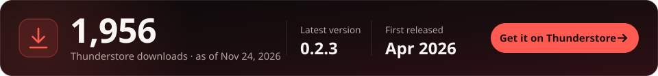
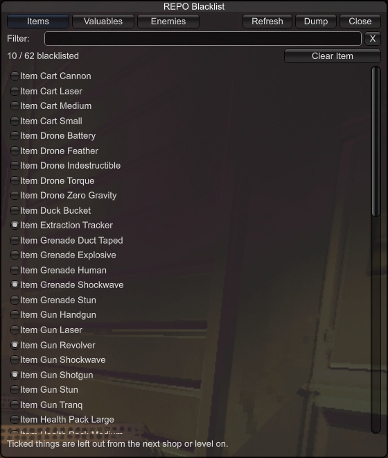
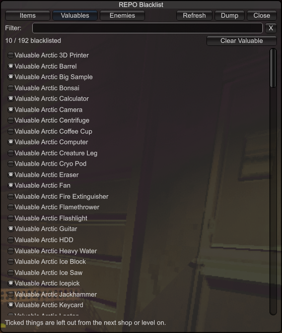
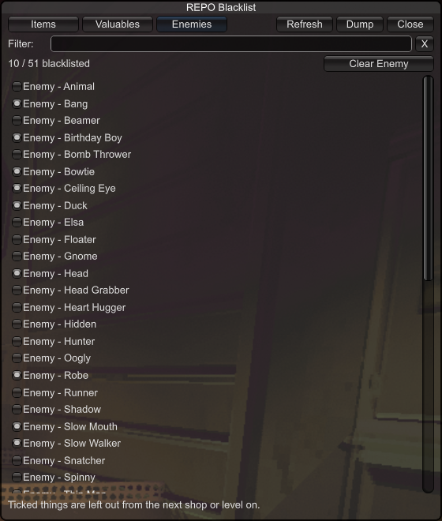

<!-- github-only:start -->
<a href="https://thunderstore.io/c/repo/p/Mentalize/REPOBlacklist/"></a>
<!-- github-only:end -->

A BepInEx plugin for R.E.P.O. that lets the host pick which shop items, level valuables, and enemies should never spawn. Selections are made through an in-game menu (default hotkey **F3**) and are kept for every save file on the install.

Only the host's blacklist takes effect: the shop, the valuables and the enemies are all chosen on the host and sent to the other players. Non-hosts can still install the mod and use the menu; their list is saved and is used the next time they host.

<!-- github-only:start -->
**Live release:** [thunderstore.io/c/repo/p/Mentalize/REPOBlacklist](https://thunderstore.io/c/repo/p/Mentalize/REPOBlacklist/) — published under the author handle Mentalize, install via Thunderstore Mod Manager or by dropping the DLL into BepInEx (see [Install](#install)).
<!-- github-only:end -->

## Using it

1. Press **F3** in the truck, the shop or a level. The menu has three tabs: **Items**, **Valuables**, **Enemies**.
2. Tick what you never want to see. The **Filter** box narrows a long list by name. Every tick is saved straight away.
3. Close with **F3**, **Esc** or **Close**.

A change takes effect from the next shop or level on. Things that are already in the current shop or level stay.

| Tab | What it leaves out |
|---|---|
| Items | The shop's stock, the secret shop included, and the upgrades an upgrade-stand reroll offers. |
| Valuables | The valuables placed in a level. |
| Enemies | The enemies picked for a level. |

Two limits:

- If you blacklist every enemy of one difficulty, a level has fewer enemies. Nothing is put in their place.
- If you blacklist every valuable a level has, the level has no valuables. Its haul goal is then $0, so the extraction point completes with nothing in it.

<p>



</p>

<!-- github-only:start -->
## Approach, tools, and assumptions

**Approach.** Up to 0.2.2 the plugin searched every loaded object for lists of items, valuables and enemies and removed blacklisted entries from them. That did not depend on the game's class names, but it also edited the game's own data (the item dictionary in `StatsManager`, the enemy lists in `EnemyDirector`), it could leave an empty enemy slot, and it stopped matching valuables once the game began storing them as prefab references. Since 0.2.3 the plugin instead hooks the methods where the game picks what to spawn and leaves the game's lists as they are. See [How the blacklist is applied](#how-the-blacklist-is-applied).

**Tools.**
- C# / .NET Standard 2.1, BepInEx 5.4.2100 (Mono build).
- HarmonyX 2.10 for the hooks, each part installed on its own so one missing method does not take the others down.
- Unity `JsonUtility` for the blacklist file.
- Unity IMGUI for the menu.
- Build via `dotnet build -c Release`; `python tools/make_package.py` builds the Thunderstore zip.

**Assumptions.**
- The game picks the shop's stock, the enemies and the valuables on the host. The hooks do nothing on a player who is not the host.
- Names are stable: the `Item` and `EnemySetup` asset names and the valuable prefab names stay the same between sessions. The blacklist file stores them as they are.
- Unity 2022.3.21 modules are compile-only references. The game itself now runs on Unity 6000.3; every Unity member the plugin calls exists in both.
<!-- github-only:end -->

## What the DLL actually does

On plugin `Awake()`, it:

- **Reads its config.** `BepInEx/config/isaia.repoblacklist.cfg` holds the menu key (`UI / MenuToggleKey`, default `F3`).
- **Loads the blacklist.** `BepInEx/config/REPOBlacklist.json` (created on the first tick) holds three sorted lists of names: `items`, `valuables`, `enemies`. The file is written to a temporary file and swapped in on every change. If it cannot be read, it is copied to `REPOBlacklist.json.bak`, the blacklist starts empty and the log says so.
- **Installs its hooks** (next section). If the game no longer has one of the methods, the log names the part that cannot work, the other parts keep working, and the menu shows which ones do.
- **Adds the menu.** Three tabs, a text filter, **Refresh**, **Dump**, **Close**, and a per-tab **Clear** with a two-click confirmation. Names that are blacklisted but not loaded by the game right now stay listed as "(not found right now)", so they can be unticked.

While the menu is open the game's controls are held still with the game's own switches (`InputManager.DisableMovement`, `DisableAiming`, `DisableControlsExcept`) and the cursor is freed with `CursorManager.Unlock`, the same calls the game's menus use. You cannot walk, look, grab or open the pause menu until it closes; push-to-talk keeps working. The game does not pause.

## How the blacklist is applied

The hooks run on the host only and leave the game's own lists as they are.

| Part | Game method | What the hook does |
|---|---|---|
| Shop items | `ShopManager.GetAllItemsFromStatsManager` | After the game has filled the shop's pools, removes blacklisted items from them, the secret-shop pools included. |
| Upgrade stand | `UpgradeStand.GetWeightedUpgradeExcluding` | If a reroll picked a blacklisted upgrade, asks the game to pick again, up to 12 times. If every try is blacklisted, that slot stays empty. |
| Enemies | `EnemyDirector.PickEnemies`, `EnemyDirector.AmountSetup` | Hands the game a copy of the difficulty's enemy list without the blacklisted ones. If nothing is left for a slot, the slot is dropped and the level's enemy count is lowered to match. |
| Valuables | `ValuableDirector.SetupHost` | Takes blacklisted valuables out of the level's lists while the game copies them, then puts them back. |

Each one writes a line to `BepInEx/LogOutput.log` when it leaves something out, for example `Shop: left out 2 blacklisted item(s): ...`. **Dump** writes which hooks are working, whether you are the host, and for each tab the blacklisted names and the names the game has loaded.

## Install

Install with a mod manager, or by hand: drop `REPOBlacklist.dll` into `<profile>/BepInEx/plugins/REPOBlacklist/`. Requires `BepInEx-BepInExPack`.

The blacklist file at `BepInEx/config/REPOBlacklist.json` is shared by every save and every lobby on that BepInEx install. Deleting it empties the blacklist. A list made with 0.2.2 is read as it is.

<!-- github-only:start -->
Thunderstore Mod Manager: open the [live release](https://thunderstore.io/c/repo/p/Mentalize/REPOBlacklist/) and click Install.

## Building from source

**Prerequisites.**
- .NET SDK 6.0 or newer (verify with `dotnet --version`).
- A local R.E.P.O. install. The csproj defaults to `C:\Program Files (x86)\Steam\steamapps\common\REPO` for its `Assembly-CSharp.dll` reference; override on the build command line with `-p:REPOPath="<your install root>"` if your install lives elsewhere.

**Build.**

```
dotnet build -c Release
```

**Output.**
- `bin/Release/netstandard2.1/REPOBlacklist.dll` — the plugin binary. Its version comes from `version_number` in `manifest.json`.

`python tools/make_package.py` builds the DLL and writes the Thunderstore zip to `dist/`. The README inside that zip leaves out the parts of this file marked `github-only`: the download card, the links to the Thunderstore page, and the sections on approach, building from source and the license.

To run locally: drop the DLL into `<BepInEx profile>/BepInEx/plugins/REPOBlacklist/` and launch the game. To publish: upload the zip via the Thunderstore web uploader.
<!-- github-only:end -->

## Compatibility

- **Checked against** R.E.P.O. v0.5.3 (Unity 6) with BepInEx 5.4.23.
- **Only the host needs it.** A non-host's list does nothing in that lobby. The menu itself works for whoever opens it.
- **Patches five game methods**, listed above, with Harmony prefixes and postfixes that do not skip the game's own code. Another mod that patches the same methods can run alongside. Nothing in Unity is patched.
- **No network traffic of its own.** A host with the mod can play with players who do not have it.
- **Content mods.** Items, enemies and valuables that a mod adds to the game's own lists show up in the menu and can be blacklisted like the game's own. This has not been tested with every content pack.

## Changelog

### 0.2.3
- Checked against the current game (R.E.P.O. v0.5.3, Unity 6).
- The blacklist is now applied where the game picks what to spawn (shop stock, upgrade-stand rerolls, enemy picks, level valuables) and no longer edits the game's own lists.
- The valuables blacklist works again, and upgrade-stand rerolls follow the items blacklist.
- Blacklisting every enemy of one difficulty gives a level fewer enemies instead of an empty slot.
- The menu holds the game's controls the way the game's own menus do, and Esc closes it. The patches on Unity's input methods are gone.
- The blacklist file is saved safely, and a file that cannot be read is kept as a `.bak` copy.

Every version is in [CHANGELOG.md](https://github.com/IsaiahAnson/REPOBlacklist/blob/main/CHANGELOG.md).

<!-- github-only:start -->
## License

Copyright (c) 2026 Isaiah Anson. All rights reserved. You may use the released software for
personal, non-commercial use; copying, modifying or redistributing it requires written
permission. See [LICENSE](LICENSE).
<!-- github-only:end -->
